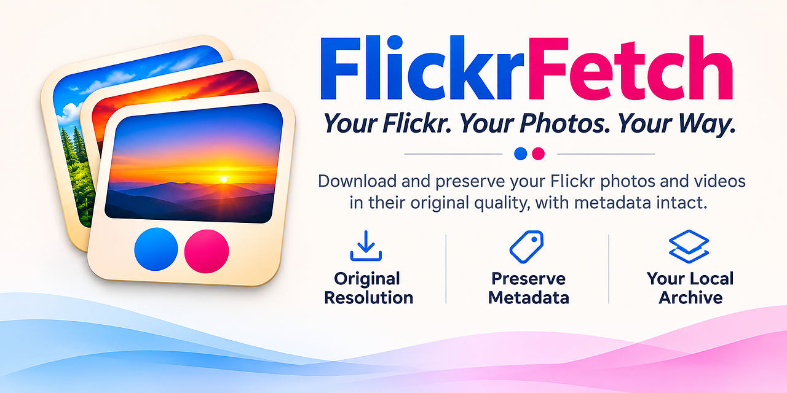

# FlickrFetch

**Your Flickr. Your Photos. Your Way.**

A Mac app that downloads your Flickr photos and videos at original quality, with your titles, tags, descriptions, dates, location and license written into the files themselves.



[**Download the latest release →**](https://github.com/wallyg/FlickrFetch/releases/latest)

macOS 11 or later · Apple Silicon (M1 and newer) · free

<!-- Screenshots: add 2–3 here (photostream grid, license filter, download history) once they're captured without private content. -->

## Why this exists

Flickr's own download tools give you the pictures, but not the story. The title, description, tags, dates and license you added over the years live on Flickr's servers, not in the JPEG you get back.

Metadata that lives only on a website disappears when the website does, or when you leave it. FlickrFetch writes it into each file using standard EXIF, IPTC and XMP fields, so your archive describes itself and works in any photo library, on any drive, with or without Flickr.

## What you get

**Your library, browsable**
- Photostream, albums and collections, in a grid that keeps real aspect ratios, or a list
- Search with operators (contains, starts with, ends with, exact), plus tag, date, privacy, photo-or-video and license filters
- A green check on photos you've already saved, and a filter for downloaded and not downloaded
- Full-size detail view with a metadata panel and video playback

**Downloading**
- Original resolution for photos and videos
- Download a whole album, a whole collection (each album into its own subfolder), or a hand-picked selection
- With filters on, **Download N shown** saves exactly what you're looking at
- A queue you can pause, resume and retry; failed photos are listed by name
- Export as individual files or a ZIP with a `manifest.json`
- **Smart Sync** skips photos you already have, or fetches only what changed since your last download
- Download history for every batch, with per-photo results
- Flexible file naming, conflict handling, Dock progress and notifications

**Metadata, written into the file**
- Title, description, tags, date taken, creator, GPS location and license (name and URL)
- Optional: the photo's Flickr URL and ID, and a sidecar `.json` file beside each photo
- Every field has its own on/off switch, and you can strip GPS from private photos

**Discover**
- Browse other photographers' public photos, groups and Explore, and filter by license to find things you're free to reuse. Please respect each photo's license and Flickr's terms.

## Privacy and safety

- **Read-only.** FlickrFetch asks Flickr for read access only. It cannot change or delete anything on your account.
- **Your files stay on your Mac.** Photos, metadata and download history are stored locally.
- **No FlickrFetch servers.** The app talks to Flickr, and to GitHub to check whether a new version is out. There is no analytics or tracking.
- The source code is public, so you can see exactly what it does.

## Install

1. Download the `.dmg` from the [latest release](https://github.com/wallyg/FlickrFetch/releases/latest).
2. Open it and drag FlickrFetch to Applications.
3. **The app isn't code-signed yet**, so macOS will likely stop you the first time. Open **System Settings → Privacy & Security**, scroll down, and click **Open Anyway**.
4. If macOS still refuses to open it, run this once in Terminal:
   ```
   xattr -cr /Applications/FlickrFetch.app
   ```
5. Open the app and sign in with your Flickr account.

## Honest limits

FlickrFetch is a personal project that has grown up. Here's what it doesn't do yet:

- **Mac only, Apple Silicon only.** No Intel Mac or Windows build.
- **Not code-signed**, hence the install step above.
- **Smart Sync trusts its own history.** It doesn't yet re-check that files are still on disk, so if you move or delete downloads, it may think they're still there.
- **No automatic or background syncing.** Downloads run when you start them.

## What's next

Under consideration for v4.0, with the theme "a backup you can trust":

- A coverage view showing what's backed up and what's missing, by album and by year
- Archive verification that finds damaged or missing files

See the [open issues](https://github.com/wallyg/FlickrFetch/issues) for everything on the list. If something here would make you use FlickrFetch, or something's missing that stops you, [open an issue](https://github.com/wallyg/FlickrFetch/issues/new) and say so. It genuinely changes what gets built.

## Build from source

Requires Node.js 18+. You'll also need your own Flickr API key from [flickr.com/services/apps](https://www.flickr.com/services/apps).

```
cp src/main/config.example.ts src/main/config.ts   # then add your key and secret
npm install
npm run dev
```

`src/main/config.ts` is gitignored. Never commit your API credentials.

`npm run build:local` makes an unsigned DMG in `dist/`.

**Built with** Electron, React and TypeScript (electron-vite), ExifTool for metadata, SQLite for download history, and electron-builder for packaging.

**Built by** Wally Gobetz, a product manager rather than a developer. I designed and tested FlickrFetch, and wrote the code with [Claude Code](https://claude.com/claude-code). Every release is tested by hand before it ships.

---

This product uses the Flickr API but is not endorsed or certified by SmugMug, Inc.

© 2026 Wally Gobetz
